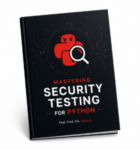

# 🔐 Mastering Security Testing for Python Applications

> **Standard security testing misses the unique risks in Python.**  
> Learn the specialized methods and tools that professional auditors actually use.

**Free to read • No registration • No tracking • CC BY-SA**

## Why Most Python Security Testing Falls Short

Standard Security Testing Isn't Enough for Python. Most checklists are not built for Python’s dynamic nature, metaprogramming, and ecosystem pitfalls.  **They miss the vulnerabilities that matter most.**

This course gives you the specialized knowledge and practical skills that **professional Python code auditors** actually use — from basic hygiene to [advanced SAST](https://github.com/nocomplexity/codeaudit) and manual exploitation.

## This Course Is For You If…

- You already test software and want to level up specifically on **Python**
- You’re a DevOps / AppSec / security engineer who keeps seeing Python code
- You’re tired of generic checklists that miss real Python risks
- You want more and better practical skills, not just theory.

This **Not** a beginner “run this tool” course. We assume you know the CLI and basic software testing.

> [!NOTE]
> This course is **not** a beginner’s course, but aims to **deepen the knowledge of professional security testers** in relation to systems built with (or containing) Python code.

## Goal of this course

> [!NOTE]
> The aim of this course is to teach you how to carry out security testing on Python programs. You do not need a strong background in Python programming to take this course.

This course is designed for developers and security enthusiasts, taking you from basic code hygiene through to advanced automated security analysis. It focuses on reliable open-source security tools to identify vulnerabilities arising from Python’s dynamic nature and the common pitfalls in its ecosystem.

It is designed to take you from a security novice to a proficient code auditor. Rather than focusing solely on theory, we will take a practical approach—identifying and resolving vulnerabilities in **Python code** using **Static Application Security Testing (SAST)** tools.

## Course Overview

Overview of modules:
1. [Module 1](module1/module1-overview): Understanding Python Security Threats.

2. [Module 2](module2/module2_overview): Choosing the Right Tools for Effective Python Security Testing.

3. [Module 3](module3/module3_overview):  Harnessing Static Application Security Testing (SAST) for Python Code and why humans are stil crucial for security testing.

4. [Module 4](module4/module4_overview): Setting up a Python Security Testing Environment.

5. [Module 5](module5/module5_overview): Detecting and Exploiting Common Python Vulnerabilities with **Python Code Audit**.

5. [Module 6](module6/module6_overview): In-Depth Analysis: Detecting and Exploiting Common Python Vulnerabilities and Hands-on exercises.

6. [Module 7](module7/module7_overview): Security Verification Beyond Testing. 

7. [Module 8](module8/module8_overview): Effective Security Reporting. 

8. [Module 9](module9/module9_overview): Course Completion & Next Steps.

## Pay what you can 

**Cybersecurity education shouldn't be a luxury.**

In an industry where online courses are often overpriced and provide little genuine value, we choose a different path. 

We believe that critical technical knowledge should be open, borderless, and accessible to everyone. True to the spirit of this course, we respect your digital sovereignty: **there are no mandatory registrations and no invasive tracking.** After all, this is a security course.

We don't want your financial situation to be a barrier to improving your skills or advancing your career. Not everyone can afford the often excessive fees attached to professional cybersecurity training. Financial circumstances should never prevent someone from developing the skills needed to grow, contribute, and thrive in the information security field.

That is why *Mastering Security Testing for Python* is offered on a pay-what-you-can basis.

The course is **completely free to read and use under the CC BY-SA licence**. If you find it valuable and are in a position to do so, we kindly invite you to make a voluntary contribution. Your support helps fund ongoing development, updates, maintenance, and the creation of new learning resources.

If you cannot contribute, please continue learning — you are very welcome here. If you can, your support makes a meaningful difference.

> [!TIP]
>  **Support This Course — Pay What You Can**
> To help more people kickstart their Infosec journey, this course is offered on a voluntary payment basis. While the content is entirely free to access under the CC-BY-SA license, we invite you to contribute what you can.

Why contribute? Your donations directly fund the ongoing maintenance, updates, and development of new high-quality security resources.

Our Mission: To [simplify cybersecurity](https://simplifysecurity.nocomplexity.com) and ensure high-level training remains a public good, not a gated commodity.

If you find this material valuable, please consider supporting our mission.

[Make a Donation](https://donate.stripe.com/28E8wP01a9846OD9KQgbm01)
